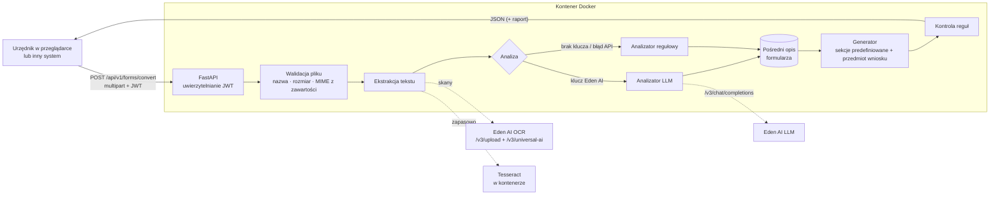

# Architektura rozwiązania — Formularze AI

## Cel

Usługa REST dla urzędników cyfryzujących formularze: przyjmuje blankiet formularza (PDF, DOC, DOCX, ODS, XLSX,
JPG, JPEG, PNG) i zwraca konfigurację eUsługi w formacie JSON gotową do importu w systemie docelowym.

## Widok ogólny

Jedyną usługą zewnętrzną jest API Eden AI udostępnione przez organizatorów wyzwania. Bez niego usługa nadal
działa w całości na jednej maszynie: analiza regułowa + lokalny OCR Tesseract.

## Moduły (`backend/app`)

| Moduł | Odpowiedzialność |
| --- | --- |
| `main.py`, `api.py` | aplikacja FastAPI, endpointy, dokumentacja OpenAPI (`/docs`), logowanie (`/api/v1/auth/token`) |
| `static/index.html` | strona WWW dla urzędnika: jeden plik HTML/CSS/JS bez zależności i bez budowania, serwowany przez tę samą usługę; korzysta tylko z publicznego REST API |
| `config.py` | konfiguracja wyłącznie ze zmiennych środowiskowych (pydantic-settings), walidowana przy starcie |
| `security.py` | wystawianie i weryfikacja tokenów JWT (HS*/RS*/ES*, wymagany `exp`, opcjonalnie `aud`/`iss`), sprawdzanie loginu i hasła w stałym czasie |
| `errors.py` | błędy domenowe → odpowiedzi `application/problem+json` z właściwym kodem HTTP |
| `files/` | lista formatów, wykrywanie MIME z zawartości, walidacja nazwy/rozmiaru, ochrona przed zip bomb |
| `extraction/` | jednolita reprezentacja tekstu (`Line`) z każdego formatu; OCR (łańcuch silników) |
| `ai/edenai.py` | klient Eden AI: chat completions, upload, OCR; błędy jako `AIError` |
| `analysis/model.py` | pośredni opis formularza (`FormAnalysis`): strony, sekcje, pola, warunki, oświadczenia, opłaty |
| `analysis/llm.py` | prompt oparty na „Standardach”, przykład z materiałów referencyjnych, walidacja odpowiedzi, ponowienie |
| `analysis/rules.py`, `lexicon.py` | analiza regułowa (tryb zapasowy) |
| `generator/builder.py` | składanie JSON: sekcje predefiniowane + przedmiot wniosku, siatka, JSONata, `flow` |
| `generator/fields.py`, `jsonata.py` | węzły JSON w kolejności kluczy z eksportów, deterministyczne UUID, warunki |
| `generator/checks.py` | kontrola reguł formularza (strony, sekcje, unikalność, odwołania w warunkach, dane inicjalne) |
| `service.py` | potok przetwarzania i raport |

## Przepływ żądania

1. **Uwierzytelnienie** — nagłówek `Authorization: Bearer <JWT>`; brak lub błąd → 401.
2. **Walidacja pliku** (`files/validation.py`):
   nazwa ≤ 250 znaków bez `; : > < / \ | ' * % $` → rozszerzenie z listy → rozmiar ≤ `MAX_FILE_SIZE_MB` →
   **typ MIME wykryty z zawartości** (sygnatury PDF/PNG/JPEG, OLE2 + strumień `WordDocument` dla DOC, struktura
   ZIP dla DOCX/XLSX/ODS) zgodny z rozszerzeniem i z zadeklarowanym `Content-Type` → limit rozmiaru po
   rozpakowaniu dla formatów ZIP.
3. **Ekstrakcja** — DOCX (python-docx; akapity, tabele, pola tekstowe, numeracja list, symbole pól wyboru),
   DOC (konwersja LibreOffice headless w katalogu tymczasowym), XLSX (openpyxl), ODS (odczyt `content.xml`
   przez defusedxml), PDF (pypdfium2; dokument bez warstwy tekstowej → OCR), JPG/PNG → OCR.
4. **Analiza** — model językowy zwraca opis części specyficznej dla wniosku jako JSON; odpowiedź jest walidowana
   schematem Pydantic (dozwolone typy pól, walidatory, źródła danych inicjalnych), a przy błędzie model dostaje
   komunikat i jedną szansę na poprawkę. Gdy model jest niedostępny — analiza regułowa.
5. **Generowanie** — patrz niżej.
6. **Kontrola** — `check_form` sprawdza wynik; problemy i ostrzeżenia trafiają do raportu (`?report=true`).

## Generowanie konfiguracji

Układ formularza wynika ze „Standardów i dobrych praktyk projektowania formularzy” oraz referencyjnych eksportów:

| Strona | Zawartość | Źródło |
| --- | --- | --- |
| „Dane” (MAIN) | urząd/organ (tylko do odczytu), podmiot wniosku, Twoje dane (MLPZ), adres zamieszkania (kraj + TERYT / adres zagraniczny), dane i adres innej osoby, dane i adres siedziby podmiotu, potwierdzenie reprezentacji, pełnomocnictwo, opłata skarbowa za pełnomocnictwo | generator; warianty zależne od tego, kto może złożyć wniosek |
| przedmiot wniosku (MAIN, 1..n) | sekcje tematyczne z polami, zależności między polami | analiza dokumentu |
| kontakt (MAIN) | opłata za usługę (jeśli jest), dane do kontaktu (MLPZ), zgody i oświadczenia (`CONSENT_SECTION`) | generator + analiza |
| „Strona końcowa” (FINISH) | podgląd (`TEXT_BLOCK`) | generator |

- **Zależności** zapisywane są w `states` jako warunki JSONata w składni eksportów, np.
  `("Innej osoby" in tabs['Dane' in title].questions['podmiot_wniosku' in field.techName].field.repeatingSectionGrid['wybierz_w_czyim_imieniu_wnioskujesz' in field.techName].field.__userAnswer)`.
- **Przepływ stron** — `flow.links` łączy kolejne strony.
- **Siatka** — sekcje i pola w jednej kolumnie (`cols: 3`), `y` narasta, `questionOrder` jak w eksportach.
- **Identyfikatory** — UUIDv5 z treści pliku: ten sam plik → ten sam JSON.
- **Nazwy techniczne** — z etykiet (transliteracja, `snake_case`), unikalne w całym formularzu.

## Interfejs WWW — dlaczego w tym samym kontenerze

Strona jest statyczna (bez logiki po stronie serwera), więc osobny kontener serwowałby tylko jeden plik, a dokładał
konfigurację, CORS i dodatkowy punkt awarii. Jedno polecenie `docker run` uruchamia całe rozwiązanie. Strona używa
wyłącznie publicznego REST API, więc w razie potrzeby można ją przenieść na osobny serwer bez zmian w kodzie.

## Bezpieczeństwo i dane

- Plik przetwarzany w pamięci; konwersja `.doc` w katalogu tymczasowym usuwanym po żądaniu (osobny profil
  LibreOffice na żądanie). Nic nie jest zapisywane trwale.
- XML parsowany przez defusedxml; limity: rozmiar pliku, rozmiar po rozpakowaniu, liczba stron PDF,
  liczba pikseli obrazu, powtórzenia wierszy/kolumn w ODS.
- Sekrety (`JWT_SECRET`, `EDENAI_API_KEY`) wyłącznie ze zmiennych środowiskowych przy uruchomieniu; komunikaty
  o błędnej konfiguracji nie wypisują wartości.
- Kontener: oficjalny obraz Alpine z przypiętą wersją, użytkownik bez uprawnień, jeden port, możliwy tryb
  `--read-only`.

## Testy

`pytest` (55+ testów): wykrywanie MIME dla każdego formatu, walidacja nazw/rozmiarów/zgodności typów,
uwierzytelnianie (brak/wygasły/podrobiony token), API end-to-end, analiza regułowa, generator (układ, warunki,
warianty wnioskodawcy, determinizm, dane inicjalne, słowniki), kontrola reguł (w tym na referencyjnych
eksportach), analizator LLM z atrapą klienta (mapowanie, ponowienie, degradacja) i przejście na reguły przy
błędzie API. Skrypty: `scripts/convert_dir.py` (przetwarzanie wsadowe), `scripts/compare.py` (porównanie
z eksportem referencyjnym).
